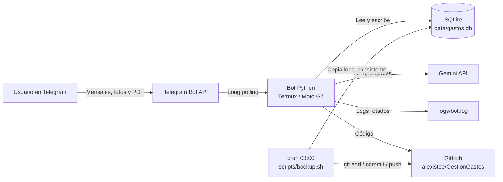

# Despliegue y operación — GestionGastos

Este documento describe cómo instalar, ejecutar, respaldar y actualizar el bot en un Moto G7 con Termux. El mismo código funciona en Linux para desarrollo.

---

## 1. Topología



El bot solo realiza conexiones salientes: long polling contra Telegram, solicitudes a Gemini y `git push` a GitHub. No expone puertos ni necesita IP pública.

---

## 2. Componentes

| Componente | Rol |
|---|---|
| `main.py` | Arranque, autenticación, logging y registro de handlers |
| `handlers/` | Interfaz de Telegram y flujos interactivos |
| `modules/` | Lógica de negocio, Gemini y persistencia |
| `database/` | Schema, seed y acceso a SQLite |
| `data/gastos.db` | Base local (no se versiona) |
| `logs/bot.log` | Log rotado de la aplicación |
| `logs/nohup.log` | Salida cruda del proceso en background |
| `scripts/` | Instalación, arranque, parada, estado y respaldo |

---

## 3. Estructura en el dispositivo

```
~/gastos/                         # repositorio clonado
├── README.md
├── Diseño/
└── Desarrollo/
    ├── .env                      # NO versionar
    ├── data/
    │   ├── gastos.db             # NO versionar
    │   └── backups/              # copias locales de la base
    ├── logs/
    │   ├── bot.log
    │   ├── nohup.log
    │   └── backup.log
    ├── scripts/
    ├── database/
    ├── handlers/
    ├── modules/
    ├── tests/
    ├── main.py
    └── requirements.txt
```

---

## 4. Requisitos

- Moto G7 con Termux (o Linux para desarrollo).
- Python 3.11 o superior.
- Git.
- Token de bot de Telegram (@BotFather).
- Chat ID autorizado.
- API key de Google AI Studio para Gemini.
- Acceso SSH a GitHub configurado en el dispositivo para el respaldo.

---

## 5. Instalación en Termux

```bash
pkg update -y
pkg install -y python git

git clone git@github.com:alexistpe/GestionGastos.git ~/gastos
cd ~/gastos/Desarrollo
bash scripts/install_termux.sh
```

El script:

1. Instala Python y Git.
2. Crea `.venv`.
3. Instala `requirements.txt` (incluye PTB con `job-queue`).
4. Copia `.env.example` a `.env` si no existe.
5. Crea `data/` y `logs/`.
6. Da permisos de ejecución a los scripts.

Después editá `.env`:

```bash
nano .env
```

---

## 6. Configuración `.env`

```env
TELEGRAM_BOT_TOKEN=...
TELEGRAM_CHAT_ID=...
GEMINI_API_KEY=...
GEMINI_MODEL=gemini-3.1-flash-lite
GEMINI_API_VERSION=v1beta

DATA_DIR=./data
LOG_DIR=./logs
DB_PATH=./data/gastos.db
LOG_LEVEL=INFO
TZ=America/Argentina/Buenos_Aires
```

Notas:

- `DB_PATH` es relativo a `Desarrollo/`. Si preferís una ruta absoluta, usá la del dispositivo.
- `.env` está en `.gitignore`: nunca se sube al repositorio.
- `TELEGRAM_CHAT_ID` debe ser el chat privado del usuario autorizado.
- Si el modelo de Gemini cambia de disponibilidad, ajustá `GEMINI_MODEL` sin tocar el código.

---

## 7. Operación

### Iniciar

```bash
cd ~/gastos/Desarrollo
./scripts/start.sh
```

El script verifica que no haya otra instancia, crea `data/` y `logs/`, y ejecuta `main.py` con `nohup`. Guarda el PID en `bot.pid`.

Para mayor estabilidad en Android, se puede adquirir un wake lock antes de iniciar:

```bash
termux-wake-lock
./scripts/start.sh
```

### Estado

```bash
./scripts/status.sh
```

Muestra si el proceso está vivo, el tamaño de la base y la última línea del log.

### Detener

```bash
./scripts/stop.sh
```

Envía SIGTERM, espera hasta 5 segundos y elimina `bot.pid`. Si se usó wake lock:

```bash
termux-wake-unlock
```

### Logs

```bash
tail -f logs/bot.log
tail -f logs/nohup.log
```

`bot.log` rota a 1 MB con 3 backups. `nohup.log` conserva la salida cruda por si el arranque falla antes de configurar logging.

---

## 8. Respaldo automático

### Instalar cron en Termux

```bash
pkg install -y cronie termux-services
sv-enable crond
crontab -e
```

Agregar:

```cron
0 3 * * * /data/data/com.termux/files/home/gastos/Desarrollo/scripts/backup.sh >> /data/data/com.termux/files/home/gastos/Desarrollo/logs/backup.log 2>&1
```

### Qué hace `scripts/backup.sh`

1. Crea una copia consistente de SQLite en `data/backups/gastos-YYYY-MM-DD.db` usando la API de backup de SQLite.
2. Ejecuta `git add -A` desde la raíz del repositorio.
3. Si no hay cambios, termina sin error.
4. Si hay cambios, hace commit con fecha y hora y ejecuta `git push origin main`.

La base, `.env` y los logs **no** se suben a GitHub; solo el código y la documentación.

---

## 9. Restauración

1. Clonar el repositorio y ejecutar la instalación.
2. Copiar o crear el `.env` con las credenciales.
3. Detener cualquier instancia.
4. Restaurar la base local desde un backup:

```bash
cd ~/gastos/Desarrollo
./scripts/stop.sh
cp data/backups/gastos-2026-11-20.db data/gastos.db
./scripts/start.sh
```

Si no hay backup local, se puede empezar con una base vacía: `main.py` ejecuta `init_db` al arrancar.

---

## 10. Actualización

```bash
cd ~/gastos/Desarrollo
./scripts/stop.sh
git pull origin main
.venv/bin/python -m pip install -r requirements.txt
./scripts/start.sh
```

Antes de actualizar, conviene ejecutar `scripts/backup.sh` y conservar la copia local de la base.

---

## 11. Seguridad

- El bot solo responde al `TELEGRAM_CHAT_ID` configurado; ignora a cualquier otro remitente.
- `.env`, `data/`, `logs/` y los comprobantes de prueba están ignorados por Git.
- Los logs redactan `TELEGRAM_BOT_TOKEN` y `GEMINI_API_KEY`; además, `httpx` y `httpcore` se fijan en `WARNING`.
- Nunca se suben claves, bases ni comprobantes al repositorio.
- Si un token se expone fuera del equipo personal, rotarlo con @BotFather y actualizar `.env`.
- Deshabilitar la optimización de batería para Termux si Android detiene el proceso.

---

## 12. Diagnóstico

| Síntoma | Revisión |
|---|---|
| El bot no arranca | `logs/nohup.log`; `.env` completo; token válido con `getMe` |
| `There is no current event loop` | `main.py` debe crear y setear el loop antes de `run_polling` |
| `job_queue` no disponible | Instalar `python-telegram-bot[job-queue]` |
| `Conflict: terminated by other getUpdates` | Hay otra instancia corriendo; usar `scripts/stop.sh` |
| `unable to open database file` | Revisar `DB_PATH` y permisos de `data/` |
| Error 404/503 de Gemini | Cambiar `GEMINI_MODEL` a un modelo disponible |
| No responde en Telegram | Verificar `bot.pid`, token, `TELEGRAM_CHAT_ID` y logs |
| Se corta en Android | Deshabilitar optimización de batería; usar `termux-wake-lock` |

---

## 13. Checklist de despliegue

- [ ] Repositorio clonado en `~/gastos`.
- [ ] `.venv` creado y dependencias instaladas.
- [ ] `.env` completo y con `DB_PATH` correcto.
- [ ] `git remote` y acceso SSH a GitHub funcionando.
- [ ] `./scripts/status.sh` responde.
- [ ] `./scripts/start.sh` arranca el bot.
- [ ] `/start` responde en Telegram.
- [ ] Un comprobante de prueba se registra y confirma.
- [ ] `analisis` devuelve datos coherentes.
- [ ] `./scripts/stop.sh` detiene el proceso.
- [ ] Cron de respaldo configurado y probado.
- [ ] Copia local de la base verificada.

---

## 14. Cambio de dispositivo y transferencia

### ¿Funciona en otro Android?

Sí. El proyecto no depende del modelo ni del hardware: solo necesita Termux, Python 3.11+ e Internet. Un Motorola, un Samsung o cualquier Android con Termux puede ejecutar el mismo código. Lo que cambia es la configuración del entorno:

- **Instalar Termux desde F-Droid o GitHub**, no desde Play Store (la versión de Play Store está desactualizada y rompe paquetes).
- **Rutas:** usá `DB_PATH=./data/gastos.db` (relativo a `Desarrollo/`) o ajustá la ruta absoluta al nuevo dispositivo.
- **Batería:** Samsung y otros fabricantes suelen ser agresivos con el segundo plano. Deshabilitá la optimización de batería para Termux, permití actividad en segundo plano y usá `termux-wake-lock` si hace falta.
- **Cron:** la ruta `crontab` debe apuntar al lugar donde clonaste el repo. Si usás `~/gastos`, la línea de ejemplo sigue siendo válida.
- **Dependencias:** desde la migración a REST/`httpx`, el proyecto no necesita compilar `pydantic-core`, `google-auth` ni `cryptography`. `pip install -r requirements.txt` instala solo PTB, `httpx` y `python-dotenv`, todos compatibles con Termux.
  - No hace falta `pkg install rust binutils` ni crear el venv con `--system-site-packages`.
  - Si ya tenías un `.venv` viejo, eliminalo y recrealo limpio.

### Qué llevar al Termux

**Opción recomendada: clonar el repositorio.**

```bash
pkg install -y python git
git clone git@github.com:alexistpe/GestionGastos.git ~/gastos
cd ~/gastos/Desarrollo
bash scripts/install_termux.sh
```

Después solo hay que llevar el `.env` por separado y, si querés conservar los datos, la base `data/gastos.db`.

**Qué NO copiar:**

- `.venv/`: el entorno virtual de Linux no es portable a Android. Se recrea con `scripts/install_termux.sh`.
- `data/`: la base se recrea o se migra aparte; no copies logs ni backups innecesarios.
- `logs/`, `.pytest_cache/`, `__pycache__/`, `bot.pid`.
- `tests/fixtures/*.png|pdf|...`: son comprobantes personales.
- `.env`: nunca va al repositorio; se transfiere por un canal privado.

**Opción manual: paquete `.tar.gz`.**

En la PC:

```bash
cd /home/ale/Files/Proyectos/MYSOFT/gastosBot/Desarrollo
./scripts/empaquetar.sh
```

El paquete queda en `../dist/gastosBot-termux-YYYYMMDD-HHMM.tar.gz` e incluye `README.md` y `Desarrollo/`, sin `.env`, sin base, sin logs, sin venv y sin fixtures.

Transferencia por `adb` (ejemplo):

```bash
adb push ../dist/gastosBot-termux-*.tar.gz /sdcard/Download/
adb push .env /sdcard/Download/env-gastos
```

En Termux:

```bash
termux-setup-storage
mkdir -p ~/gastos
tar -xzf ~/storage/downloads/gastosBot-termux-*.tar.gz -C ~/gastos
cp ~/storage/downloads/env-gastos ~/gastos/Desarrollo/.env
cd ~/gastos/Desarrollo
bash scripts/install_termux.sh
nano .env      # ajustar DB_PATH si hace falta
./scripts/start.sh
```

### Migrar la base existente

La base SQLite es portable entre dispositivos. Con el bot detenido en la PC:

```bash
# En la PC
cd /home/ale/Files/Proyectos/MYSOFT/gastosBot/Desarrollo
./scripts/stop.sh
adb push data/gastos.db /sdcard/Download/gastos.db
```

En Termux:

```bash
mkdir -p ~/gastos/Desarrollo/data
cp ~/storage/downloads/gastos.db ~/gastos/Desarrollo/data/gastos.db
```

Luego iniciá el bot. Si preferís empezar de cero, no copies la base: `main.py` crea el schema y el seed automáticamente.

### Checklist de cambio de dispositivo

- [ ] Termux instalado desde F-Droid/GitHub.
- [ ] Repo clonado o paquete extraído en `~/gastos`.
- [ ] `.env` transferido por un canal privado y con `DB_PATH` correcto.
- [ ] `.venv` recreado en el dispositivo.
- [ ] Base migrada (opcional) o creada desde cero.
- [ ] Optimización de batería deshabilitada para Termux.
- [ ] `./scripts/start.sh` y `/start` funcionando.
- [ ] Cron de respaldo apuntando a la ruta correcta.
